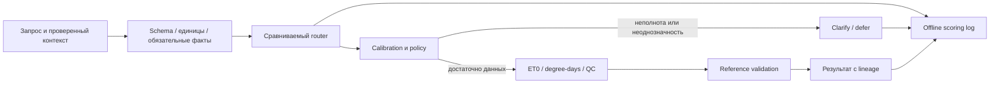

# Выбранная рабочая тема научной статьи

Дата: 30.09.2026. **Предлагаемая тема и план исследования; аграрный эксперимент ещё не выполнен.** Утверждение преподавателем не получено.

## 1. Русский заголовок

**Калиброванная маршрутизация агрометеорологических запросов с отказом от ненадёжного выбора расчётного инструмента.**

## 2. English title

**Calibrated Routing of Agrometeorological Queries with Abstention from Unreliable Calculation Tool Selection.**

## 3. Альтернативные формулировки

- «Оценка надёжности выбора инструментов ИИ-агентом для агрометеорологических расчётов» — проще для первичного согласования.
- «Селективная маршрутизация запросов агронома: качество, неопределённость и стоимость вычислительного пайплайна» — акцент на evaluation.
- «Сравнение правил и моделей принятия решений при выборе инструментов расчёта агроклиматических показателей» — наиболее нейтрально, подходит и при отрицательном результате ML.

## 4. Почему тема подходит

Уже есть опыт sidecar decision model, выбора из каталога с none, shadow mode, freezes, paired benchmark, latency/timeouts и сохранения происхождения данных. Это подтверждено Jev-проектом, а не только сохранёнными постами. Аграрная задача требует освоить ET0 и degree-days, но не покупать датчики, собирать proprietary images или обучать foundation model. Проект используется как инженерная база; старые developer labels/results не являются агроэкспериментом. Подробности: PERSONAL_RESEARCH_MAP_RU.md.

## 5. Исследовательская проблема

Агрометеорологический запрос может быть неоднозначен, содержать разные единицы или не задавать обязательный параметр. Корректный инструмент при неправильном выборе/аргументе даст неверный результат. Нужна проверка, когда семантический router полезен и когда он должен уточнить или воздержаться. ET0 — reference evapotranspiration, а не готовая норма полива; сумма температур требует явной base temperature и определения формулы.

## 6. Объект

Автоматизированная обработка запросов для расчёта и проверки агрометеорологических показателей по открытым погодным данным.

## 7. Предмет

Влияние семантической маршрутизации, post-hoc калибровки и политики отказа на ошибки выбора/исполнения, coverage, задержку и стоимость.

## 8. Цель

Разработать воспроизводимый стенд и экспериментально установить, снижает ли калиброванная селективная маршрутизация риск ошибочного исполнения относительно простых правил и локальных ML-baselines при сопоставимом уровне автоматизации.

## 9. Задачи

1. Описать три предметных инструмента, их входы, единицы, допустимые области и критерии достаточности данных.
2. Подготовить открытые weather snapshots и независимый размеченный корпус запросов, включая RU/EN, ambiguity и unsupported cases.
3. Реализовать rule, TF-IDF/embedding и decision-model варианты через единый интерфейс.
4. Отделить route probability, аргументы и numerical executor; откалибровать вероятность правильного маршрута на независимом subset.
5. Провести grouped holdout, ablations и тесты устойчивости при одинаковом бюджете ошибок/эскалаций.
6. Сравнить качество, риск/coverage, p95 end-to-end и стоимость; описать отрицательные результаты и пределы переноса.

## 10. Гипотеза

На неявных и неоднозначных запросах learned router с независимой калибровкой сможет увеличить coverage корректного исполнения при фиксированном selective risk относительно rule/lexical baseline. Эффект не предполагается на каждом классе: на простых явных запросах правила могут быть точнее и быстрее. Гипотеза отклоняется, если CI сравнения не поддерживает выигрыш либо выигрыш исчезает на untouched группах/после учёта отказов.

## 11. Предполагаемая научная новизна

Возможный вклад — узкий агрометеорологический benchmark с numerical oracle, grouped holdout и **совместной оценкой semantic routing, calibration, abstention и end-to-end correctness**. Уточняется цена ошибки выбора при неполных входах и единицах. Внедрение Jev, типизированный JSON или formula wrapper сами по себе не новизна. Не заявляется первенство: существуют AgriAgent, AgroTools и CottonBot; проверка ближайших работ и пробелов — LITERATURE_REVIEW_RU.md.

## 12. Практическая значимость

Небольшой проверяемый модуль для аналитика/агронома: запрос → подходящая операция или объяснимое уточнение. Он может уменьшить количество неверных расчётных запусков; полевую экономию воды, рост урожайности и безопасное автономное управление орошением эта статья не доказывает.

## 13. Данные

- [NASA POWER Daily API](https://power.larc.nasa.gov/docs/services/api/temporal/daily/): cached historical daily data 2020–2025 для нескольких agricultural regions, AG community. Сохранять URL параметров, дату, hash, metadata/units и UTC/LST. Координаты демонстрационные, без личных ферм.
- [FAO-56](https://www.fao.org/4/x0490e/x0490e00.htm): reference ET0 definition и numerical validation. Проверить temperature/humidity/radiation/pressure/wind height и преобразования единиц.
- **Собственный routing corpus**: 300–500 независимых scenarios, allowed route set, facts, clarification flag, gold arguments/result. Естественные запросы агронома предпочтительнее одной LLM-генерации; expert-reviewed controlled scenarios маркируются отдельно.
- [AgroTools](https://huggingface.co/datasets/AgroTools/AgroTools) — внешний prior art, optional comparator. Не основной dataset: мультимодален, лицензия other; перенос текстового Jev к изображениям без perception model некорректен.

Все ссылки проверены 30.09.2026. Малый weather snapshot уже получен: [NASA POWER, семь дней](examples/research-2026-09-30/nasa-weather-week.json), с метаданными единиц и [контрольными суммами](examples/research-2026-09-30/manifest.json). Полные массивы остальных источников не загружены. Следующий этап — проверить достаточность входов каждого расчёта и экспертную разметку запросов. Этот срез температуры/осадков сам по себе недостаточен для полного FAO-56 ET₀.

## 14. Методы

Rule routing; supervised text classifier; embedding similarity; optional Jev choice/LLM function calling. Probability calibration (temperature scaling, Platt/isotonic при подходящем сигнале) выбирается по dev/calibration и размеру данных. Confidence TypeSafe — характеристика распределения, не автоматически вероятность правильности всего pipeline; для Brier/ECE использовать определённое событие и оценку вероятности.

Policy разрешает execute, clarify, defer; hard preconditions/schema/unit validation исполняет код. Запрос без необходимой base temperature нельзя молча дополнить типовой температурой культуры. ET0 не вычислять при недостатке исходных данных, если метод gap-filling отдельно не включён в scope и не проверен.

## 15. Baselines

1. Regex/keywords + deterministic preconditions.
2. TF-IDF + logistic regression со своим calibration split.
3. Embedding nearest-description с одинаковым каталогом; пороги similarity не объявлять вероятностями.
4. Generative tool calling с фиксированным schema/model/prompt и теми же входами.
5. Oracle route — верхняя граница и диагностика argument/executor ошибок, не конкурент ML.

Jev — optional измеряемый backend. Не требует копирования ключей из другого проекта; API-сравнение возможно позже через собственную безопасную конфигурацию. Для воспроизводимости статья должна сохранять локальный baseline и versioned predictions. CLM в названии не используется: значение не установлено.

## 16. Метрики

Route macro-F1 и допустимый route-set accuracy; clarification precision/recall; risk=wrong executed/total executed; coverage executed/all и executed/answerable; AURC. Brier/ECE для calibrated route correctness; worst-group metrics по языкам, намерениям и неполноте данных. End-to-end success требует верных аргументов/единиц и численного результата с заранее заданной absolute+relative tolerance. p50/p95 учитывает cold/warm, failures, retry и сеть; cost/correct completion включает все оплаченные запросы. Numeric error не считать только на cherry-picked успехах.

## 17. План эксперимента

1. **Неделя 1:** 60 development scenarios, три executor functions, numerical spot checks и rule baseline. Эти примеры не идут в независимый final test.
2. **Неделя 2:** 300–500 сценариев, expert label review, allowed alternatives, split по semantic family, author, weather-window; RU/EN пары одной группы не разносить.
3. **Неделя 3:** train-development/calibration/final-test ориентировочно 50/20/30%; обучить/заморозить baselines, получить immutable predictions. Уточнить split sizes до запуска по независимым группам и доступности calibration.
4. **Неделя 4:** final comparison, paired cluster bootstrap, CIs, wrong-tool/argument/numeric/timeouts decomposition. Порог заранее выбрать по dev-calibration; одинаковую coverage достигать frozen policies, на test threshold не подбирать.
5. **Недели 5–6:** untouched OOD authors/groups, ablations, error analysis и статья. Если данных мало для risk bound, прямо ограничить вывод пилотным исследованием.

Controls: keyword traps («не рассчитывай ET0, проверь данные»), missing mandatory facts, °F/°C, solar-energy units, wind-height, date shifts, unavailable tool, unsupported request. Не все numerical faults видны router: layer responsibilities оцениваются отдельно. Перестановка названий/описаний каталога — robustness test; test labels скрыты до записи прогнозов. Старый developer holdout не использовать как agricultural test. Conformal bounds optional и только при проверенных предпосылках exchangeability; под OOD не обещать гарантий.

## 18. Ожидаемые результаты

Ожидаемые артефакты: dataset+schema+licenses, reference executors, frozen splits/config, predictions, calibration/risk-coverage plots, cost table и failure taxonomy. Численный выигрыш не прогнозируется заранее. Даже отсутствие ML-выигрыша полезно при честной демонстрации границ и сильных baselines; публикация не гарантируется.

## 19. Риски

Недостаточно independent scenarios; эксперт не согласен с labels; rules решают задачу целиком; hosted API обновился; RU/OOD calibration падает; API/единицы изменились; структура synthetic corpus выдаёт label. Mitigation: pilot, allowed label sets, schema versioning, independent holdout, open local baseline, recorded predictions, grouped CI. Если classifier ничего не добавляет, сохранить отрицательный результат и сузить статью к failure analysis, а не расширять систему.

## 20. Структура статьи

Введение и аграрная задача; related work; инструменты/датасет/разметка; routing/calibration/policy; baselines и protocol; results; ablations/errors; limitations/reproducibility; заключение. Раздел results заполняется только после измерений.

## 21. Архитектура прототипа

Предлагаемые отдельные модули: data_ingestion → contracts → routers → calibration → policy → executors → evaluation. JSONL+SQLite достаточно; новый orchestration framework не требуется. Каталог, schema, модель и источник versioned. Изменять существующий SciAgg для этого не нужно: будущий агроэксперимент размещается отдельно.

## 22. Минимальный прототип

Три ordinary Python functions, 60 размеченных development queries, JSONL runner, rule+TF-IDF варианты, unit/precondition guard и CSV ошибок. Первый релиз работает offline на cached data без API-ключей. Jev добавляется только как сравниваемая модель; использование hosted API не является обязательным условием темы.

## 23. Что показать сегодня

Сам заголовок, object/subject/goal, тестируемую гипотезу, диаграмму и таблицу baselines. Пример: «Сумма эффективных температур за неделю» → уточнить базовую температуру; «ET0 по FAO-56 на полном метеонаборе» → numerical executor; «Какой полив нужен завтра?» без культуры/почвы/полного метода → defer. Это **иллюстрации запланированной policy**, а не выводы уже обученного агроагента. В дополнение показать реально работающий SciAgg demo и существующий опыт typed routing; не выдавать parser-demo за сельскохозяйственный эксперимент.
